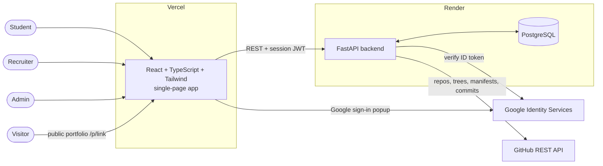
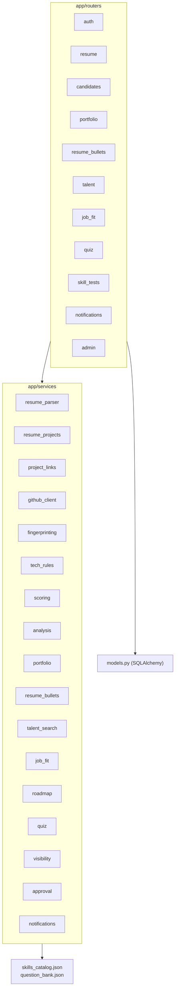
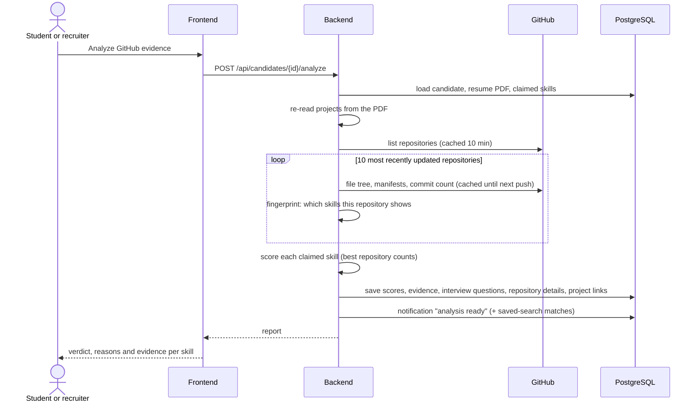
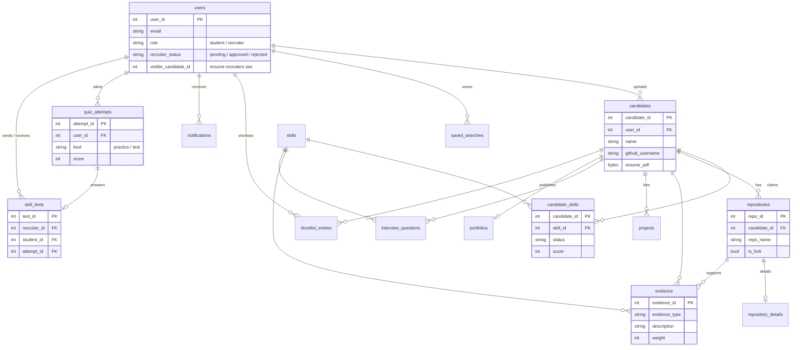

# Architecture

## System

- **Frontend** (`code/frontend`): pages in `src/pages`, shared parts in `src/components`, API calls
  and types in `src/lib`. `lib/api.ts` adds the session token to every request; `AuthContext`
  remembers the signed-in user; `App.tsx` maps URLs to pages and checks roles.
- **Backend** (`code/backend/app`): each feature has a **router** (HTTP, who is calling, database
  reads and writes) and a **service** with the logic, most of it pure functions tested without a
  database.
- **Database**: PostgreSQL through SQLAlchemy. New tables are created on startup
  (`create_all`); new columns on existing tables are added by `database.ensure_columns()`.

## Backend structure

| Service | Responsibility |
|---|---|
| `resume_parser`, `resume_projects` | Text from the PDF (pdfplumber), name (spaCy), skills, GitHub link, projects with tech stack and dates |
| `github_client` | GitHub REST calls, in-memory cache, rate-limit detection |
| `fingerprinting`, `tech_rules` | Scan a repository's files and manifests and decide which catalog skills it shows |
| `scoring`, `analysis` | Score each claimed skill, pick reasons and supporting repositories, write interview questions |
| `project_links` | Match resume projects to repositories by name |
| `portfolio`, `resume_bullets` | Public portfolio content; resume lines, optionally tailored to a job description |
| `talent_search` | Recruiter search, ranking, comparison |
| `job_fit`, `roadmap` | Fit of each resume to a job or role; skill gap roadmap |
| `quiz` | Question picking, option shuffling, grading |
| `visibility`, `approval`, `notifications` | Which resume recruiters see; recruiter approval; in-app notifications |

## How an analysis runs

If GitHub's hourly limit runs out, the analysis stops with "try again in about N minutes" rather
than treating unreadable repositories as empty.

## Data model

Other tables: `repository_details` (technologies, signals, push date), `projects` (title,
description, tech stack, period), `interview_questions`, `portfolios` (public link, headline),
`saved_searches`, `shortlist_entries` (private notes), `notifications`.

## Access rules

- Sign-in: Google ID token verified on the backend; `@thapar.edu` → student, other emails →
  recruiter (pending until approved, unless the domain is in `RECRUITER_AUTO_APPROVE_DOMAINS`).
  Admins are listed in `ADMIN_EMAILS`.
- Students see only their own uploads. Recruiters see each student's one visible resume.
- Practice results are private to the student; skill test results go to the recruiter who sent
  the test.
- Public portfolio pages need no sign-in and show only what the student published.
