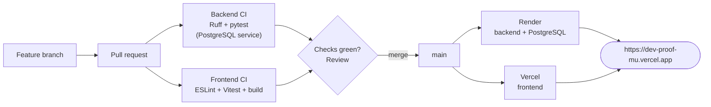

# CI/CD and deployment

## Checks on every pull request

| Workflow | File | Runs when | Steps |
|---|---|---|---|
| Backend CI ("Lint + test") | `.github/workflows/backend-ci.yml` | `code/backend/**` changes | Python 3.11, install requirements + spaCy model, `ruff check .`, `pytest` against a PostgreSQL service container |
| Frontend CI ("Lint + test + build") | `.github/workflows/frontend-ci.yml` | `code/frontend/**` changes | Node 20, `npm ci`, `npm run lint`, `npm test`, `npm run build` |

At the time of writing: 220 backend tests in 34 files, 54 frontend tests in 16 files.

## Deployment

| Part | Platform | Config | Notes |
|---|---|---|---|
| Frontend | Vercel (Hobby) | `code/frontend/vercel.json`, root directory `code/frontend` | Env: `VITE_API_BASE`, `VITE_GOOGLE_CLIENT_ID`. Every path is sent to `index.html`, so `/p/<link>` opens directly. |
| Backend | Render (free web service) | `render.yaml` (Blueprint) | Python 3.11, installs the spaCy model, starts `uvicorn`, health check `/health`. Env: `GOOGLE_CLIENT_ID`, `GITHUB_TOKEN`, `ADMIN_EMAILS`, `FRONTEND_ORIGINS`; `JWT_SECRET` generated. |
| Database | Render PostgreSQL (free) | `render.yaml` | `DATABASE_URL` linked automatically. Resume PDFs are stored here because the server's disk is wiped on restart. |

Merging into `main` redeploys both automatically. Step-by-step setup is in the
[README](../README.md#deploy).

Free-plan behaviour: the backend sleeps after 15 minutes without requests (the next request takes
about a minute), and the free database is time-limited.
